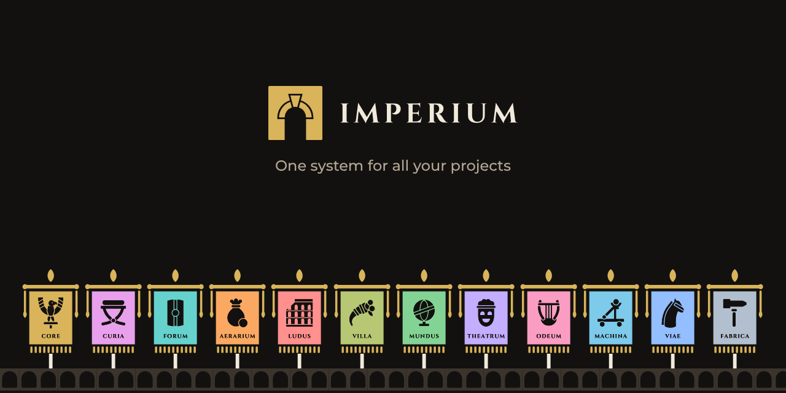

  

**Imperium** is a suite of 130 game systems, organised in 12 families modelled on the architecture of a game engine. Each system bears the Latin name of its role, and that name stays the same from one engine to the next: `Lux` is lighting, `Lictor` is the anticheat, `Tabularius` saves player data.

> One system for all your projects.

## The 12 families

| Family | Domain | Systems |
|---|---|---|
| **Core** | Shared services | 9 · Conditor, Lex, Signum… |
| **Curia** | Staff tools | 9 · Senatus, Consul, Praetor… |
| **Forum** | Social & community | 18 · Ianitor, Tiro, Optio… |
| **Aerarium** | Economy | 6 · Quaestor, Mercator, Negotiator… |
| **Ludus** | Gameplay & progression | 19 · Gradus, Salus, Statio… |
| **Villa** | Survival, crafting, life sim | 8 · Cellarius, Artifex, Structor… |
| **Mundus** | Environment | 19 · Lux, Caelum, Hora… |
| **Theatrum** | Rendering | 15 · Pictor, Figura, Textura… |
| **Odeum** | Audio | 4 · Sonus, Cantus, Murmur… |
| **Machina** | Simulation & engine logic | 8 · Impetus, Res, Mens… |
| **Viae** | Networking & data | 5 · Veredarius, Hospes, Tessera… |
| **Fabrica** | Developer tools | 10 · Augur, Faber, Architectus… |

## Repositories

| Repository | Contents |
|---|---|
| [`imperium`](https://github.com/imperium-systems/imperium) | The reference: system catalogue, public interfaces, naming rules. |
| [`roblox`](https://github.com/imperium-systems/roblox) | The Roblox implementation, in Luau. |

Unity, Unreal Engine, Godot and custom engines will follow, behind the same interfaces.

## One name, every engine

Each system defines its public interface once, for example "set the time of day to 18:00" on `Hora`, and each engine implements it. The name never changes; only the casing follows the conventions of each language.

| Engine | Language | Where it lives | Call |
|---|---|---|---|
| Roblox | Luau | `Imperium/Mundus/Hora` | `Hora.SetTime(18)` |
| Unity | C# | `namespace Imperium.Mundus` | `Hora.SetTime(18)` |
| Unreal Engine | C++ | plugin `Imperium`, module `ImperiumMundus` | `UHora::SetTime(18)` |
| Godot | GDScript | `addons/imperium/mundus/hora` | `Hora.set_time(18)` |
| Godot | C# | `namespace Imperium.Mundus` | `Hora.SetTime(18)` |
| Custom engine | C++ | `imperium::mundus::hora` | `hora::set_time(18)` |
| Custom engine | C# | `namespace Imperium.Mundus` | `Hora.SetTime(18)` |
| Custom engine | C | `imperium/mundus/hora.h` | `imperium_hora_set_time(18)` |
| Custom engine | Java | `io.github.imperium_systems.mundus` | `Hora.setTime(18)` |
| Custom engine | Python | `imperium.mundus.hora` | `hora.set_time(18)` |
| Custom engine | Rust | `imperium::mundus::hora` | `hora::set_time(18)` |
| Web | TypeScript | `@imperium-systems/mundus` | `Hora.setTime(18)` |

Code that calls a system does not change when the engine underneath does.

Imperium is in active development.